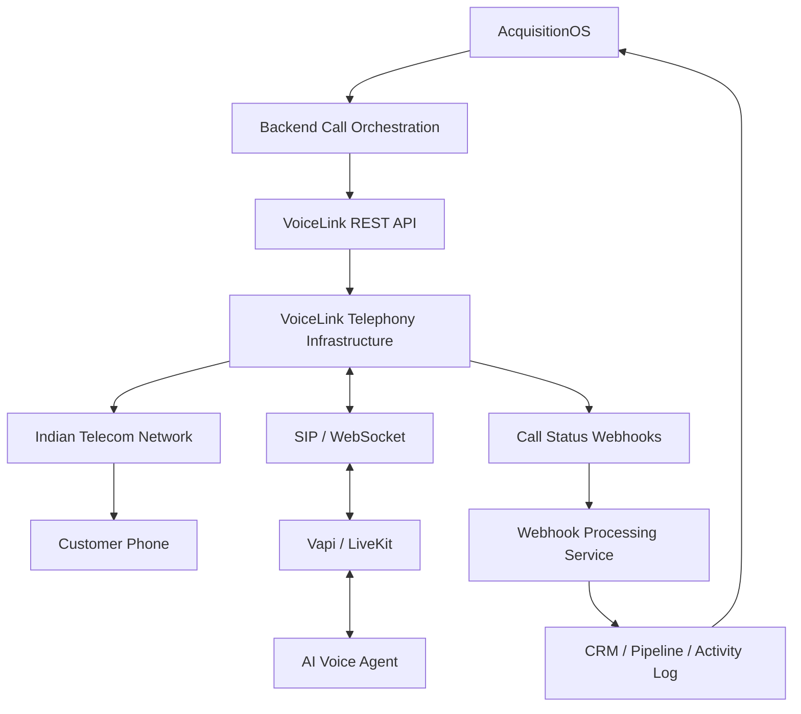
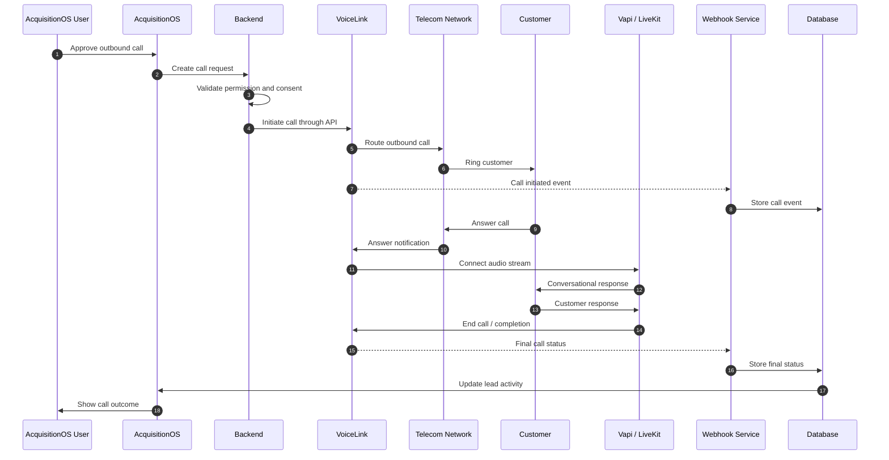
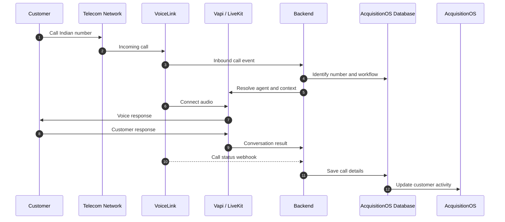
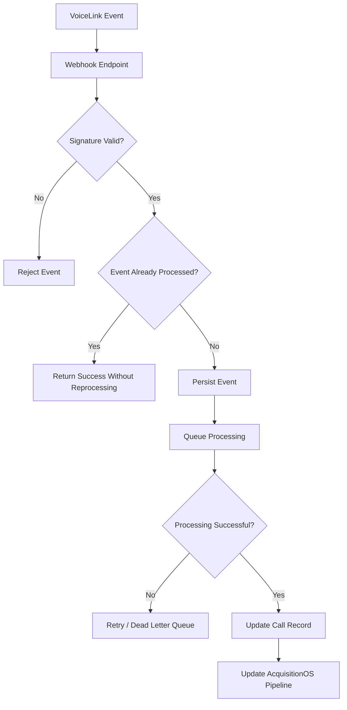
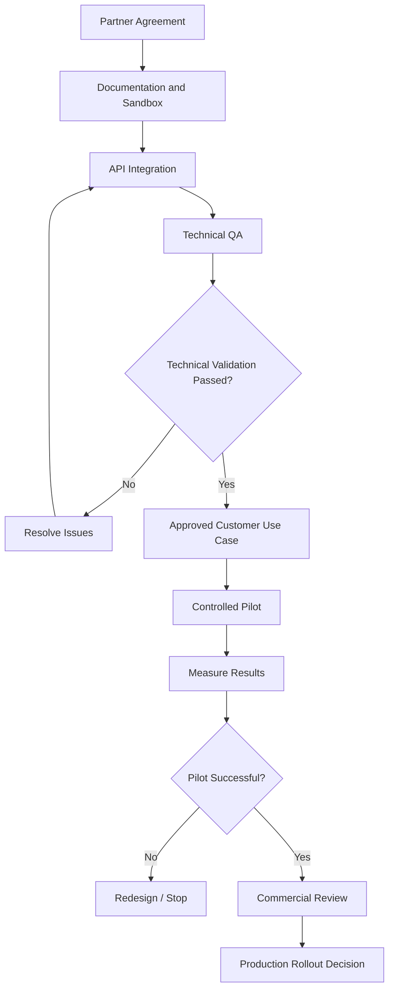
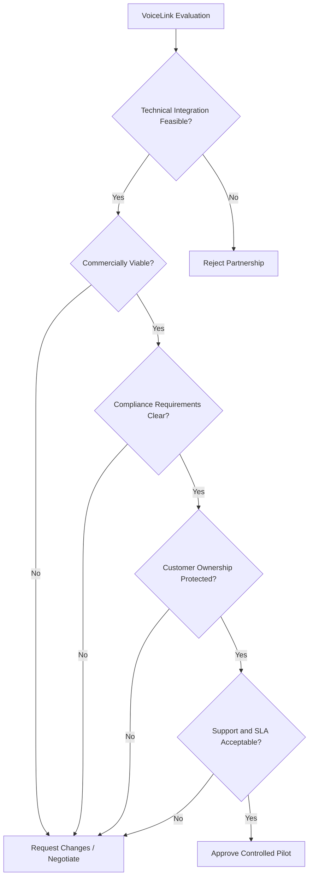

# VoiceLink × Paragonel Technologies
## Technology & Reseller Partnership — Complete Meeting Preparation & Technical Evaluation

**Document Date:** 18 November 2026  
**Meeting:** VOICE LINK DEMO – Paragonel Technologies  
**Meeting Date:** Wednesday, 18 November 2026  
**Meeting Time:** 2:30 PM – 3:30 PM IST  
**Duration:** 60 Minutes  
**Company:** Paragonel Technologies Pvt. Ltd.  
**Product:** AcquisitionOS  
**Founder:** Prabhat Kumar  
**Technical Lead:** Md Tausif  
**Meeting Organizer:** Geetha S  
**Platform:** Google Meet  
**Meeting Link:** https://meet.google.com/wkp-pawp-bsr

---

# TABLE OF CONTENTS

1. Executive Summary
2. Meeting Details and Confirmation
3. Purpose and Expected Outcomes
4. Email Conversation — Complete Chronological Record
5. Stakeholder Intelligence
6. Company and Product Positioning
7. VoiceLink Technical Overview
8. Telephony Concepts Explained
9. Founder Pitch and Business Positioning
10. VoiceLink Published Pricing
11. Commercial Analysis and Cost Calculations
12. Reseller Partnership and Negotiation Strategy
13. Proposed Technical Architecture
14. API, Webhook and Integration Requirements
15. Vapi and LiveKit Integration Evaluation
16. Compliance, Privacy and Security
17. Questions VoiceLink May Ask
18. Questions Paragonel Must Ask
19. Proposed Pilot Implementation
20. Pilot Success Metrics
21. Meeting Agenda
22. Founder and Technical Lead Responsibilities
23. Meeting Closing Strategy
24. Commercial and Technical Red Flags
25. Public Company and Product Research
26. Partnership Presentation — 9 Slides
27. One-Page Meeting Cheat Sheet
28. Pre-Meeting Checklist
29. Post-Meeting Action Plan
30. Technical QA and Acceptance Checklist
31. Decision Framework
32. Risks and Mitigation
33. Reference Sources and Verification Notes

---

# 1. EXECUTIVE SUMMARY

## 1.1 Partnership Opportunity

Paragonel Technologies Pvt. Ltd. is evaluating VoiceLink, a telephony infrastructure platform from Elision Technologies, as a potential Indian telephony partner.

The objective is to integrate voice capabilities into AcquisitionOS and potentially offer voice-enabled business automation solutions to customers.

This evaluation covers:

- VoiceLink API integration.
- Inbound and outbound calling.
- SIP and WebSocket connectivity.
- Vapi and LiveKit compatibility.
- AI voice-agent integration.
- Webhook-based call event processing.
- Reseller and technology partnership.
- Client-level account management.
- Wholesale pricing and recurring revenue.
- Indian telecom compliance.
- Technical support and SLA.
- Controlled customer pilot.

## 1.2 What Paragonel Wants

Paragonel is not simply looking for a telephony subscription.

The objective is to establish a repeatable technology partnership in which:

| Responsibility | Organization |
|---|---|
| Product and customer workflow | Paragonel |
| AcquisitionOS platform | Paragonel |
| Customer relationship | Paragonel, subject to contract |
| AI-agent orchestration | Paragonel / selected AI platform |
| Indian telephony infrastructure | VoiceLink |
| Number provisioning | VoiceLink, subject to onboarding |
| Telephony APIs | VoiceLink |
| Call routing | VoiceLink |
| Call event delivery | VoiceLink |
| Customer-facing solution | Paragonel |
| Telecom infrastructure support | VoiceLink, as contractually agreed |

## 1.3 Primary Meeting Objectives

By the end of the meeting, Paragonel should obtain:

1. Official API documentation.
2. Sandbox or test environment access.
3. Supported SIP/WebSocket integration architecture.
4. Confirmation of Vapi and LiveKit compatibility.
5. Written reseller pricing.
6. Customer-level account and billing structure.
7. Client ownership and data portability terms.
8. KYC and compliance requirements.
9. Named technical integration contact.
10. Agreed pilot scope and next steps.

**Current commercial position:** Technical and commercial evaluation only. No production integration, guaranteed call volume or purchase commitment has been established.

---

# 2. MEETING DETAILS AND CONFIRMATION

## 2.1 Calendar Information

| Field | Details |
|---|---|
| Meeting Title | VOICE LINK DEMO – Paragonel Technologies – 13570 |
| Date | Wednesday, 18 November 2026 |
| Time | 2:30 PM – 3:30 PM |
| Time Zone | Asia/Kolkata |
| Organizer | Geetha S |
| Guest 1 | Prabhat Kumar |
| Guest 2 | Utsav Kikani |
| Meeting Platform | Google Meet |
| Meeting Status | Accepted |
| Duration | 60 minutes |

**Google Meet:** https://meet.google.com/wkp-pawp-bsr

The calendar invitation was accepted from Prabhat's mailbox.

## 2.2 Confirmed and Unconfirmed Participants

**Confirmed calendar guests:**

- Geetha S
- Prabhat Kumar
- Utsav Kikani

**Other individuals appearing in email correspondence:**

- Sonal Gupta
- Ankur Sharma
- Vidhi Kanabar

Their appearance in the email correspondence does not establish confirmed attendance.

---

# 3. PURPOSE AND EXPECTED OUTCOMES

This meeting has three primary dimensions.

## 3.1 Technology Integration

Evaluate whether VoiceLink can provide the required infrastructure for:

- Outbound calls.
- Inbound calls.
- AI-powered conversations.
- SIP connectivity.
- WebSocket audio streaming.
- REST API integration.
- Webhook event notifications.
- Call recording retrieval.
- Human handoff.
- Call status tracking.

## 3.2 Technology and Reseller Partnership

Evaluate whether Paragonel can:

- Become an official VoiceLink reseller.
- Onboard multiple customers.
- Manage client-level accounts.
- Allocate channels and DIDs.
- View individual customer usage.
- Offer telephony as part of its own solutions.
- Maintain its customer relationship.
- Establish recurring revenue.

## 3.3 Commercial and Operational Model

Understand:

- Wholesale pricing.
- Retail pricing flexibility.
- Reseller margins.
- Channel charges.
- DID rental.
- CPS limits.
- Minimum commitments.
- Taxes.
- KYC requirements.
- Support structure.
- SLA.
- Data ownership.
- Customer migration.

## 3.4 Definition of Meeting Success

The meeting should not be judged by how impressive the product demo looks.

It should be judged by whether the following deliverables are agreed:

| Deliverable | Expected Outcome |
|---|---|
| API documentation | Access or committed delivery date |
| Sandbox | Test access or onboarding procedure |
| Technical contact | Named engineering contact |
| Reseller pricing | Written quotation |
| Customer management | Clear multi-client architecture |
| Compliance | Written requirements |
| Pilot | Defined scope |
| Next meeting | Date and responsible owners |

---

# 4. EMAIL CONVERSATION — COMPLETE CHRONOLOGICAL RECORD

The following is the distinct conversation supplied from the connected mailbox research, with duplicated quoted history and email signatures removed.

## 4.1 6 November 2026 — Initial Outreach

**Time:** 8:29 AM IST  
**From:** Prabhat Kumar  
**To:** Elision Technologies Team

**Subject:** Paragonel × VoiceLink — reseller/API fit for an acquisition workflow product

> Hello Elision Technologies team,
>
> I reviewed VoiceLink’s platform and noticed two specific points: it lists 40+ voicebot integrations, and its “Voice AI Companies” model includes a multi-user reseller setup with client-level management and DID resale. The current welcome offer is also published through 30 November 2026.
>
> I’m Prabhat Kumar, founder of Paragonel Technologies Pvt. Ltd. We’re preparing AcquisitionOS, our lead-qualification and follow-up operating layer, for production. We are evaluating a compliant Indian telephony layer for inbound/outbound workflow execution; we have not integrated VoiceLink or committed production call volumes.
>
> Would you clarify whether VoiceLink onboards early-stage product companies as technology/reseller partners, and what API/webhook access, test environment, KYC/DLT obligations, account-level billing and partner pricing look like? A brief technical/commercial fit call would be useful if this is within your partner model.
>
> Regards,  
> Prabhat Kumar  
> Founder, Paragonel Technologies Pvt. Ltd.

## 4.2 16 November 2026 — Positive Response

**Time:** 12:18 PM IST  
**From:** Sonal Gupta  
**To:** Prabhat Kumar

**Subject:** VoiceLink Technology & Reseller Partnership

> Hi Prabhat,
>
> Thank you for sharing the details about Paragonel Technologies and AcquisitionOS.
>
> We would be happy to discuss our technology and reseller partnership model, API/webhook integration, onboarding requirements, and commercial possibilities.
>
> Could you please share your contact number and convenient time to connect for a brief discussion?
>
> Best Regards,  
> Sonal Gupta  
> Lead Generation, Elision Technologies

## 4.3 16 November 2026 — Prabhat's Response

**Time:** 8:12 PM IST  
**From:** Prabhat Kumar  
**To:** Sonal Gupta

**Subject:** Re: VoiceLink Technology & Reseller Partnership

> Hi Sonal,
>
> Thank you for the positive response. We are interested in evaluating a technology/reseller partnership around VoiceLink, particularly the API/webhook integration and a bounded pilot for an opted-in customer workflow.
>
> I can coordinate the discussion over email and Google Meet. Please share 2–3 convenient 20-minute time slots and include the relevant technical/API owner so we can cover partner onboarding, API/webhook capabilities, commercial terms, client ownership and pilot prerequisites in one discussion.
>
> If a phone call is required, please let me know and I will share a suitable contact number separately.
>
> Regards,  
> Prabhat Kumar  
> Founder | Paragonel Technologies Pvt. Ltd.  
> AcquisitionOS — a Paragonel product

## 4.4 17 November 2026 — Meeting Availability

**Time:** 10:27 AM IST  
**From:** Sonal Gupta  
**To:** Prabhat Kumar

> Hi Prabhat,
>
> Thank you for your response.
>
> We have two available slots today for the discussion:
>
> - 1:00 PM – 1:30 PM
> - 5:00 PM onwards
>
> Please let me know which slot works best for you.
>
> Looping in Geetha S as well for the partnership discussion.
>
> Looking forward to connecting.

## 4.5 17 November 2026 — Calendar Invitation

**Time:** 11:54 AM IST

**Event:** VOICE LINK DEMO – Paragonel Technologies – 13570

- Wednesday, 18 November 2026.
- 2:30 PM – 3:30 PM IST.
- Organizer: Geetha S.
- Guests: Geetha S, contact@prabhat.online, Utsav Kikani.

## 4.6 17 November 2026 — Meeting Link

**Time:** 11:56 AM IST  
**From:** Geetha S  
**To:** Prabhat Kumar

> Dear Sir,
>
> Greeting!
>
> As discussed with Mrs. Sonal, Please find the attached meeting link below:
>
> VOICE LINK DEMO – Paragonel Technologies – 13570  
> Wednesday, November 18 · 2:30 – 3:30pm  
> Time zone: Asia/Kolkata
>
> Google Meet joining info  
> Video call link: https://meet.google.com/wkp-pawp-bsr

## 4.7 17 November 2026 — Calendar Acceptance

**Time:** 12:00 PM IST

> Prabhat has accepted this invitation.

---

# 5. STAKEHOLDER INTELLIGENCE

## 5.1 VoiceLink / Elision Stakeholders

| Person | Verified Information | Recommended Approach |
|---|---|---|
| Geetha S | Meeting organizer and person who sent the meeting link | Partnership coordination, onboarding and commercial discussion |
| Utsav Kikani | Listed as a calendar guest; public LinkedIn search associates him with Elision | Establish his exact role and whether he owns technical, sales or partner operations |
| Sonal Gupta | Lead Generation in email signature; public LinkedIn result associates her with Elision | Initial relationship and coordination |
| Ankur Sharma | Elision official team page lists him as VP – Sales (Domestic) | Commercial escalation and partnership terms if present |
| Vidhi Kanabar | Appears in email correspondence; not established as a confirmed guest | Do not assume attendance or responsibility |

## 5.2 Public Research Limitations

- Ankur Sharma's designation is identified through Elision's official team page.
- Sonal Gupta's public LinkedIn result associates her with Elision Technologies.
- Utsav Kikani's public LinkedIn result associates him with Elision, but his precise responsibility remains unverified.
- The supplied Md Tausif LinkedIn profile could not be reliably retrieved. No unsupported professional history, certifications or technical skills should be attributed to him.

## 5.3 Paragonel Delegation

### Prabhat Kumar — Founder

Responsibilities:

- Company positioning.
- Product positioning.
- Partnership strategy.
- Customer ownership.
- Commercial negotiation.
- Pricing and margins.
- Contractual decisions.
- Pilot approval.
- Final business decisions.

### Md Tausif — Senior Technical Engineer

Responsibilities:

- Integration architecture.
- API authentication.
- API feasibility.
- Webhook validation.
- SIP/WebSocket feasibility.
- Vapi/LiveKit compatibility.
- Security.
- Error handling.
- Technical QA.
- Performance and reliability assessment.

**Important:** The technical lead should validate engineering claims, but commercial and partnership decisions remain with the founder.

---

# 6. COMPANY AND PRODUCT POSITIONING

## 6.1 About Paragonel Technologies

Paragonel Technologies Pvt. Ltd. is a product-focused technology company building software products and business automation solutions.

Its positioning includes:

- B2B SaaS.
- AI-enabled business workflows.
- Enterprise software.
- Product development.
- Business automation.
- Technology partnerships.

Paragonel is evaluating VoiceLink as infrastructure that could support voice-enabled workflows across its product ecosystem.

## 6.2 About AcquisitionOS

AcquisitionOS is Paragonel's AI-powered Client Acquisition Operating System.

It connects the client-acquisition lifecycle into one workspace.

### AcquisitionOS — 12-Stage Workflow

1. Discover.
2. Research.
3. Find Gaps.
4. Opportunity Report.
5. Score.
6. Personalize.
7. Outreach.
8. Reply.
9. Meeting.
10. Pipeline.
11. Proposal.
12. Close.

### Existing Product Capabilities and Roadmap Context

- Prospect discovery.
- Business research.
- Opportunity identification.
- Lead scoring.
- Personalized outreach.
- Multi-channel engagement.
- Follow-up automation.
- Reply management.
- Meeting workflows.
- Pipeline management.
- Proposal generation.
- Deal closure workflows.

Voice should be evaluated as an additional interaction channel, not as a replacement for the entire AcquisitionOS platform.

## 6.3 Why Voice Matters

Potential use cases:

- Opted-in lead qualification.
- Customer follow-up.
- Appointment reminders.
- Meeting confirmation.
- Sales inquiry handling.
- Customer support routing.
- Business workflow automation.
- Human handoff.
- Call outcome synchronization with CRM.

## 6.4 Product Readiness Position

Use this exact distinction:

| Area | Position |
|---|---|
| AcquisitionOS product | Under development and production preparation |
| VoiceLink integration | Not yet completed |
| Production voice traffic | Not committed |
| Vapi/LiveKit selection | Under evaluation |
| Telephony provider | Under evaluation |
| Customer pilot | Proposed, subject to agreement |

Never represent a proposed integration as a completed production integration.

---

# 7. VOICELINK TECHNICAL OVERVIEW

VoiceLink is positioned as Indian telephony infrastructure for voicebot builders and AI SaaS platforms.

Its publicly described capabilities include:

- Indian telephone numbers.
- Inbound calling.
- Outbound calling.
- SIP connectivity.
- WebSocket connectivity.
- REST APIs.
- Call routing.
- Call recordings.
- Bot-to-human handoff.
- Multi-user reseller management.
- DID resale.
- Channel allocation.
- CPS allocation.

The October 2026 release notes also mention integrations involving:

- LiveKit.
- Pipecat SDK.
- Inbound calling.
- Outbound calling.

These features must be validated through current documentation and an actual demonstration.

## 7.1 Four-Layer Architecture

| Layer | Responsibility | Example |
|---|---|---|
| Product layer | Business workflows and customer management | AcquisitionOS |
| AI layer | Speech processing and conversational intelligence | Vapi / LiveKit |
| Telephony layer | Phone numbers and call connectivity | VoiceLink |
| Network layer | Actual telephone network | Indian telecom network |

### Important Distinction

- Vapi or LiveKit can power the conversational intelligence.
- VoiceLink can provide Indian telephony connectivity.
- AcquisitionOS can orchestrate when to call, whom to call, what context to provide, what to record and what happens after the call.

---

# 8. TELEPHONY CONCEPTS EXPLAINED

## 8.1 SIP — Session Initiation Protocol

SIP is a signalling protocol used to establish, manage and terminate voice sessions.

In simple terms, SIP helps connect the voice agent to the telephone network.

It typically handles:

- Session initiation.
- Call establishment.
- Call routing.
- Session modification.
- Call termination.

## 8.2 WebSocket

WebSocket provides a persistent, bidirectional communication connection.

In voice AI systems, it can carry real-time audio between the telephony provider and the voice-agent service.

It matters because a conversational system should be able to process audio continuously rather than waiting for an entire recording to finish.

## 8.3 REST API

REST APIs allow AcquisitionOS to communicate with VoiceLink through HTTP requests.

Potential operations:

- Initiate outbound call.
- Retrieve call status.
- Fetch call metadata.
- Retrieve recordings.
- Manage numbers.
- Retrieve account usage.

Exact endpoint availability must be confirmed.

## 8.4 Webhook

A webhook is an HTTP callback sent by a provider when an event occurs.

### Example Call Lifecycle

1. AcquisitionOS requests an outbound call.
2. VoiceLink starts the call.
3. VoiceLink sends a call-started webhook.
4. Customer answers.
5. AI voice agent handles the conversation.
6. Call ends.
7. VoiceLink sends the final call status.
8. AcquisitionOS updates the lead and activity history.

Production webhook handling must consider:

- Authentication.
- Signature validation.
- Retry behaviour.
- Duplicate events.
- Event ordering.
- Timeout handling.
- Idempotency.
- Persistent event logging.

## 8.5 CPS — Calls Per Second

CPS means Calls Per Second.

It measures how many new calls a system can initiate per second.

CPS is different from simultaneous calls.

### Important Terms

| Term | Meaning |
|---|---|
| Channel | Telephony capacity allocated for calls |
| Concurrency | Number of simultaneous active calls |
| CPS | Number of calls initiated per second |
| DID | Direct Inward Dialing telephone number |
| SIP | Voice session signalling |
| WebSocket | Persistent bidirectional communication |
| Webhook | Event callback |
| KYC | Know Your Customer verification |

Ask VoiceLink to explain the relationship between channels, concurrency, CPS, DIDs and per-client allocation.

---

# 9. FOUNDER PITCH AND BUSINESS POSITIONING

## 9.1 60-Second Opening Pitch

> Thank you for taking the time to meet with us.
>
> I'm Prabhat Kumar, founder of Paragonel Technologies. We are building B2B software products, with AcquisitionOS as our primary client-acquisition operating system.
>
> AcquisitionOS brings prospect discovery, business research, qualification, personalized outreach, follow-ups and pipeline management into one workflow. We are evaluating voice capabilities as another execution channel within that ecosystem.
>
> We are not looking for a basic telephony subscription. We want to evaluate a long-term technology partnership where VoiceLink provides compliant Indian telephony infrastructure and Paragonel owns the product experience, customer workflow and business relationship.
>
> Our technical team is here to validate the integration architecture, API and webhook capabilities, reliability and onboarding process.
>
> From the business side, I want to understand the reseller model, customer ownership, commercial structure and how we can start with a controlled pilot.
>
> We would prefer to validate the integration with a small opted-in use case first, measure the results and then scale based on actual demand.

## 9.2 If They Ask: What Exactly Do You Want?

> We want API and webhook access, a test environment, supported SIP/WebSocket integration, clear onboarding and compliance requirements, partner pricing, client-level account management and an agreed support process.
>
> We also want clarity on whether we can onboard and manage our own customers under a reseller structure.

## 9.3 If They Ask: What Is AcquisitionOS?

> AcquisitionOS is an AI-powered client acquisition operating system. It connects prospect discovery, research, opportunity identification, scoring, personalized outreach, replies, follow-ups, meetings, pipeline, proposals and deal closure.
>
> Voice is a potential additional interaction channel, not the entire product.

## 9.4 If They Ask: Why VoiceLink?

> Our priority is reliable Indian telephony, compliance, API access and a commercially sustainable partner model.
>
> We are evaluating VoiceLink because of its Indian-number capabilities, SIP/WebSocket support and reseller offering.
>
> We will make the decision after validating the integration and commercial terms.

---

# 10. VOICELINK PUBLISHED PRICING

**Pricing source:** VoiceLink official website, as reported in the research conducted for this document.

These are published rates, not negotiated Paragonel reseller rates.

## 10.1 Published Plans

| Component | Pay As You Go | Unlimited |
|---|---:|---:|
| Channel/month | ₹99 | ₹999 |
| Inbound/minute | ₹0.25 | ₹0 |
| Outbound/minute | ₹0.50 | ₹0 |
| Indian number/month | ₹299 | ₹299 |

Additional pricing:

- Custom: Volume-based quotation.

## 10.2 Pricing Interpretation

The published Unlimited plan is advertised at ₹999 per channel/month with zero per-minute inbound/outbound charges.

Indian number rental is listed separately at ₹299/month.

However, the following require written confirmation:

- Whether channels mean simultaneous calls.
- Whether unlimited calling has fair-use limits.
- Whether CPS is included.
- Whether number rental includes setup.
- Whether minimum commitments apply.
- Whether GST is extra.
- Whether reseller pricing differs from public pricing.

---

# 11. COMMERCIAL ANALYSIS AND COST CALCULATIONS

## 11.1 Assumptions

The following calculations assume:

- One telephony channel.
- One Indian number.
- Outbound-only usage.
- No GST.
- No setup fees.
- No additional charges.
- Published rates remain applicable.

### Pay As You Go Formula

\[
C_{PAYG} = 99 + 299 + (0.50 \times M)
\]

Where \(M\) represents outbound minutes.

### Unlimited Formula

\[
C_{Unlimited} = 999 + 299
\]

Therefore:

\[
C_{Unlimited} = ₹1,298
\]

## 11.2 Example Monthly Costs

| Monthly Outbound Minutes | Pay As You Go | Unlimited |
|---:|---:|---:|
| 1,000 | ₹898 | ₹1,298 |
| 1,800 | ₹1,298 | ₹1,298 |
| 2,000 | ₹1,398 | ₹1,298 |
| 3,000 | ₹1,898 | ₹1,298 |

## 11.3 Break-Even Analysis

The difference between the two channel charges is:

\[
999 - 99 = ₹900
\]

For outbound-only usage:

\[
\frac{900}{0.50} = 1,800
\]

**Outbound break-even: approximately 1,800 minutes per channel/month.**

For inbound-only usage:

\[
\frac{900}{0.25} = 3,600
\]

**Inbound break-even: approximately 3,600 minutes per channel/month.**

For mixed usage:

\[
C_{Variable} =
(0.25 \times I) + (0.50 \times O)
\]

Where:

- \(I\) = inbound minutes.
- \(O\) = outbound minutes.

Compare the variable usage cost with the ₹900 difference in channel fees.

## 11.4 Costs Not Included

The telephony calculation does not include:

- Vapi subscription.
- LLM API tokens.
- Speech-to-text.
- Text-to-speech.
- AI-agent hosting.
- Recording storage.
- Backend hosting.
- Database costs.
- Monitoring.
- Customer support.
- Taxes.
- Additional telecom charges.

### Total Cost of Voice AI

\[
C_{Total} =
C_{Telephony} +
C_{AI} +
C_{Infrastructure} +
C_{Storage} +
C_{Operations}
\]

Do not evaluate profitability using telephony pricing alone.

---

# 12. RESELLER PARTNERSHIP AND NEGOTIATION STRATEGY

## 12.1 What Paragonel Wants

- Official reseller status.
- Wholesale pricing.
- Multiple customer accounts.
- Customer-level usage tracking.
- Separate billing visibility.
- DID allocation.
- Channel allocation.
- CPS allocation.
- Technical support.
- Partner account management.
- Customer ownership protection.
- Data portability.
- Volume discounts.

## 12.2 Negotiation Statement

> We want to build a repeatable channel, not purchase a single number for one internal project.
>
> Can you share your reseller price slabs, client-level billing model and volume-based discounts?
>
> We would prefer a low-risk pilot first, followed by a commercial arrangement based on actual usage.

## 12.3 Desired Commercial Conditions

| Requirement | Preferred Position |
|---|---|
| Pilot | Low-risk evaluation |
| Setup fees | Waived or reduced if possible |
| Minimum commitment | None before pilot validation |
| Reseller discount | Written pricing slabs |
| Customer accounts | Multiple client-level accounts |
| Billing | Separate customer-level usage |
| Retail pricing | Paragonel pricing flexibility |
| Volume discounts | 5, 10, 25 and 50 channels |
| Customer ownership | Contractually protected |
| Data portability | Available upon termination |
| Exclusivity | Not accepted without clear commercial benefit |

## 12.4 Commercial Questions

1. Is ₹99/₹999 charged per simultaneous channel?
2. Does one channel mean one concurrent call?
3. Is there a separate CPS charge or limit?
4. Is ₹299 charged per DID per month?
5. Are there number setup or deposit charges?
6. Does Unlimited genuinely have zero per-minute inbound/outbound charges?
7. Are there minimum monthly commitments?
8. Are GST and other taxes extra?
9. What is the reseller wholesale price?
10. Can Paragonel set its own customer price?
11. Can Paragonel create multiple client accounts?
12. Can usage and wallet balances be separated by customer?
13. Are discounts available at 5, 10, 25 and 50 channels?
14. What happens to customer numbers and call records if the partnership ends?

---

# 13. PROPOSED TECHNICAL ARCHITECTURE

## 13.1 High-Level Architecture

The architecture separates product orchestration, telephony connectivity and conversational intelligence.



## 13.2 Component Responsibilities

| Component | Responsibility |
|---|---|
| AcquisitionOS | Business workflow and customer context |
| Backend Orchestration | Call initiation, permissions and execution |
| VoiceLink REST API | Telephony API requests |
| VoiceLink Infrastructure | Number provisioning and call routing |
| Indian Telecom Network | Actual call connectivity |
| SIP/WebSocket | Voice connectivity |
| Vapi/LiveKit | AI conversational processing |
| Webhook Service | Call event reception |
| CRM/Pipeline | Call results and activity history |

## 13.3 Outbound Call Flow



## 13.4 Inbound Call Flow



## 13.5 Webhook Event Processing



## 13.6 Architecture Principles

The implementation should support:

- Secure API authentication.
- Idempotent call initiation.
- Webhook signature validation.
- Duplicate event prevention.
- Retry handling.
- Persistent event logs.
- Call status reconciliation.
- Customer-level isolation.
- Usage tracking.
- Secret management.
- Recording access control.
- Human escalation.

---

# 14. API, WEBHOOK AND INTEGRATION REQUIREMENTS

## 14.1 API Authentication

Questions:

- API key or OAuth?
- Signed requests?
- Token expiry?
- Token rotation?
- IP allowlisting?
- Separate credentials per customer?
- Role-based access?
- Sandbox and production credential separation?

## 14.2 Outbound Calling

Questions:

- Which API endpoint initiates an outbound call?
- What request parameters are required?
- How is the destination number validated?
- Can the caller ID be selected?
- Can the AI agent be selected?
- Is there an idempotency key?
- What happens when the request times out?
- How is call initiation success returned?

## 14.3 Inbound Calling

Questions:

- How are incoming calls routed?
- Can calls be routed to a selected AI agent?
- Can routing depend on the DID?
- Can routing depend on business hours?
- Is human fallback supported?
- Can inbound calls be transferred?

## 14.4 Webhooks

Questions:

- Which events are available?
- How are callbacks authenticated?
- Are event IDs unique?
- Are webhook signatures supported?
- What is the retry policy?
- What happens if our endpoint returns HTTP 500?
- Are events delivered in order?
- Can failed events be replayed?

## 14.5 Call Lifecycle Events

The exact supported event names must be confirmed.

Required event coverage:

| Event | Expected Behaviour |
|---|---|
| Call initiated | Create initial call record |
| Ringing | Update call status |
| Answered | Record answer time |
| Busy | Mark call busy |
| Failed | Store failure reason |
| Completed | Mark call completed |
| Disconnected | Record termination |
| Recording available | Retrieve recording metadata |
| Transfer initiated | Track handoff |
| Transfer completed | Update call destination |

## 14.6 SIP

Questions:

- Can Paragonel connect its own SIP endpoint?
- What SIP credentials are required?
- Is IP whitelisting necessary?
- Which codecs are supported?
- Is TLS supported?
- Is SRTP supported?
- How are SIP errors reported?
- Are there connection restrictions?

## 14.7 WebSocket

Questions:

- Which audio formats are supported?
- Which codecs are supported?
- Which sample rates are supported?
- Is streaming bidirectional?
- How are audio chunks framed?
- How is session termination handled?
- What are timeout limits?
- How is reconnection handled?

## 14.8 Recordings and Metadata

Questions:

- Can recordings be fetched through API?
- Are transcripts available?
- Is call metadata available?
- Are timestamps included?
- Can recordings be disabled?
- Can recording retention be configured?
- Can data be exported?

---

# 15. VAPI AND LIVEKIT INTEGRATION EVALUATION

## 15.1 Vapi Preference

Paragonel previously expressed a preference for Vapi as the conversational AI layer.

Ask:

> We prefer Vapi for the conversational AI layer, provided the integration is technically supported and commercially viable in India.
>
> Do you have a documented Vapi integration with VoiceLink for both inbound and outbound calls?
>
> Can you show us the exact configuration and any limitations?

## 15.2 LiveKit Evaluation

The October 2026 release notes reportedly mention LiveKit and Pipecat integrations.

Validate:

- Supported SDK version.
- Official documentation.
- Inbound call support.
- Outbound call support.
- Audio streaming architecture.
- Session management.
- Call transfer.
- Error handling.
- Production support.
- Maintenance ownership.

## 15.3 Integration Comparison

| Dimension | Vapi | LiveKit |
|---|---|---|
| Primary role | Voice-agent platform | Real-time communication framework |
| Conversational AI | Platform-provided capabilities | Requires configured agent components |
| Customization | Depends on platform support | Greater architectural control |
| Integration | Must verify VoiceLink compatibility | Must verify supported VoiceLink integration |
| Operational complexity | Depends on configuration | Potentially higher |
| Production suitability | Must validate | Must validate |

No final architecture should be selected until both technical feasibility and total cost are understood.

## 15.4 Critical Clarification

A generic SIP integration does not automatically establish that every Vapi feature works.

Likewise, the mention of LiveKit in release notes does not establish production suitability for Paragonel's exact requirements.

Request:

1. Documentation.
2. Supported versions.
3. Working configuration.
4. Inbound demo.
5. Outbound demo.
6. Limitations.
7. Named technical support contact.

---

# 16. COMPLIANCE, PRIVACY AND SECURITY

Telecom compliance is a commercial and operational requirement, not an optional feature.

## 16.1 Questions to Ask

- Which number series are available for the proposed use case?
- What KYC documents are needed for Paragonel?
- What KYC documents are needed for customers?
- Who is responsible for telecom registration?
- What consent evidence must be retained?
- How are promotional and transactional calls distinguished?
- What restrictions apply to automated or AI-generated calls?
- How are opt-outs handled?
- How are do-not-call requests enforced?
- Where are recordings stored?
- Where is call metadata stored?
- What is the retention period?
- Can recordings be disabled?
- Is a Data Processing Agreement available?
- What is the incident response process?
- What is the deletion procedure?

## 16.2 Number Series

VoiceLink's public material reportedly describes:

- 140-series promotional numbers.
- 1600-series transactional numbers.
- DLT scrubbing for promotional calls.

These are product claims to validate with VoiceLink.

They do not establish that every proposed AI calling workflow is automatically compliant.

## 16.3 Compliance Responsibility Matrix

| Responsibility | Clarification Required |
|---|---|
| Number provisioning | VoiceLink |
| Customer KYC | VoiceLink / customer |
| Consent collection | Paragonel / customer, as applicable |
| Calling permissions | All relevant parties |
| Opt-out management | Paragonel / customer |
| DLT requirements | Confirm contractually |
| Recording access | Confirm contractually |
| Data retention | Confirm contractually |
| Security incidents | Defined joint process |

## 16.4 Security Requirements

Minimum expectations:

- HTTPS/TLS.
- Secure API credentials.
- Secret rotation.
- Webhook signature verification.
- Role-based access.
- Tenant isolation.
- Encryption at rest.
- Restricted recording access.
- Audit logs.
- Data retention controls.
- Incident reporting.

## 16.5 SLA Discrepancy

Public product material reportedly contains different uptime claims:

- One page: 99.99%.
- Another case-study section: 99.9%.

Request the actual contractual SLA.

Clarify:

- Measurement period.
- Exclusions.
- Planned maintenance.
- Incident notification.
- Service credits.
- Escalation process.
- Support availability.

---

# 17. QUESTIONS VOICELINK MAY ASK

## Q1. What Does Paragonel Do?

> Paragonel Technologies is a product-focused technology company. We build software products and develop technology solutions for businesses.
>
> AcquisitionOS is our client-acquisition operating system, and we are evaluating complementary infrastructure partners to extend its capabilities.

## Q2. Is AcquisitionOS Already Live?

> We are preparing it for production and validating integrations.
>
> We are not presenting this particular VoiceLink integration as already completed. We want to validate the technical and commercial fit before committing to a production rollout.

## Q3. Do You Have Existing Customers?

> We are developing our customer and partnership pipeline and evaluating early use cases.
>
> We want to start with an opted-in pilot rather than make unsupported volume commitments. Once the workflow is validated, we can build a realistic rollout forecast.

Do not claim hundreds of paying customers without evidence.

## Q4. What Monthly Call Volume Do You Expect?

> We have not committed to a production volume yet.
>
> We would like to understand the pricing at different usage levels and validate the economics through a pilot. After that, we can share a realistic forecast.

## Q5. Why Do You Want to Become a Reseller?

> We want to deliver a complete customer workflow rather than send customers to a separate telephony vendor.
>
> A reseller relationship could allow us to package the telephony infrastructure with our software, maintain the customer experience and generate recurring revenue while relying on your telecom infrastructure and support.

## Q6. Why VoiceLink Instead of Twilio or Another Provider?

> Our priority is reliable Indian telephony, compliance, API access and a commercially sustainable partner model.
>
> We are evaluating VoiceLink because of its Indian-number capabilities, SIP/WebSocket support and reseller offering. We will make the decision after validating the integration and commercial terms.

## Q7. What Is Your Expected Partnership Commitment?

> Initially, a technical evaluation and a bounded pilot.
>
> We would prefer to agree on a repeatable commercial model after validating the customer workflow and operational requirements.

## Q8. Which Technology Stack Do You Use?

> Our backend stack is Java and Spring Boot, with a cloud-hosted application architecture.
>
> We are evaluating the voice-agent layer separately from the telephony layer so that we can integrate through documented APIs and supported protocols.

## Q9. Do You Need SIP or WebSocket?

> We want to understand both options.
>
> SIP may be suitable for a standard telephony-to-agent connection, while WebSocket may be relevant for real-time audio streaming and custom agent orchestration.
>
> We would choose based on the supported architecture and latency requirements.

## Q10. Do You Already Have a Vapi or LiveKit Implementation?

> We have a preferred architecture in mind, but we are validating the provider-specific integration.
>
> We want to review your official documentation, supported SDKs and a working example before finalizing the implementation.

## Q11. Can You Handle High Call Volume?

> We will design the orchestration and backend for controlled concurrency, retry handling and event processing.
>
> We would need your channel, CPS and account-level limits so we can size the integration correctly.

## Q12. How Will You Handle Failed Calls and Duplicate Events?

> We intend to use idempotent call initiation, unique call identifiers, webhook signature validation, retry handling and a persistent event log.
>
> We want to confirm how your API and webhook infrastructure supports these patterns.

## Q13. Are You Ready to Purchase a Plan Today?

> We are ready to evaluate the plan and agree on the pilot requirements.
>
> We would prefer not to make a recurring commitment until the API integration and cost structure have been validated.

## Q14. Can You Guarantee Volume?

> Not before the pilot.
>
> We would rather provide a realistic forecast based on actual customer demand than promise an artificial number.

## Q15. What Margin Do You Expect?

> We are looking for a commercially viable reseller structure that leaves room for customer acquisition, onboarding, support and product development.
>
> We would like to understand your wholesale pricing tiers before proposing a retail structure.

---

# 18. QUESTIONS PARAGONEL MUST ASK

## Priority 1 — Partnership and Customer Ownership

1. Do you formally onboard early-stage product companies as VoiceLink resellers?
2. Can Paragonel create and manage multiple customer accounts?
3. Can we own the end-customer relationship and customer-facing billing?
4. Do you have a non-circumvention or customer-protection clause?
5. Can customers be migrated if the reseller relationship ends?
6. Can customer call records and data be exported?
7. Can Paragonel independently manage customer support?

## Priority 2 — API and Integration

1. Can you provide API documentation?
2. Is sandbox access available?
3. Is Vapi officially supported for Indian inbound and outbound calls?
4. What exactly is supported for LiveKit and Pipecat?
5. Are webhook signatures supported?
6. What is the retry policy?
7. Is idempotency supported?
8. What are the channel and CPS limits?
9. Who will be our technical integration contact?

## Priority 3 — Pricing

1. What is the wholesale reseller price?
2. Is there a separate DID charge?
3. Is there a separate channel charge?
4. Is CPS chargeable?
5. Are there setup or wallet charges?
6. Are there minimum monthly commitments?
7. Can we use pay-as-you-go for the pilot?
8. How are customer usage and invoices separated?
9. What volume discounts are available?

## Priority 4 — Support, SLA and Compliance

1. What is the contractual uptime SLA?
2. What is the escalation path for a failed production call?
3. What KYC requirements apply?
4. What consent requirements apply?
5. What is the recording retention period?
6. Can we disable recordings?
7. What compliance responsibilities remain with Paragonel?
8. Is a Data Processing Agreement available?
9. What support is available outside business hours?

---

# 19. PROPOSED PILOT IMPLEMENTATION

## 19.1 Pilot Scope

**Proposed scope:** One customer and one opted-in customer workflow.

This is a proposal subject to technical and commercial agreement, not an existing commitment.

## 19.2 Phase 1 — Technical Validation

- API authentication.
- Sandbox access.
- One test DID or approved test number.
- Outbound call initiation.
- Inbound call routing if supported.
- Webhook delivery.
- Event validation.
- Vapi or LiveKit integration.
- Recording retrieval.
- Failure handling.

## 19.3 Phase 2 — Controlled Customer Pilot

- One approved use case.
- Limited consented call list.
- Limited call concurrency.
- Human escalation where required.
- Call logs.
- Outcome tracking.
- Cost measurement.
- Customer feedback.

## 19.4 Phase 3 — Review

Evaluate:

- Connection rate.
- Answer rate.
- Completion rate.
- Audio quality.
- Latency.
- Failed-call rate.
- Webhook reliability.
- Cost per completed call.
- Customer feedback.
- Qualified conversations.
- Meetings or completed business outcomes.

## 19.5 Pilot Workflow



---

# 20. PILOT SUCCESS METRICS

| Metric | Measurement |
|---|---|
| Call initiation success | Successful call creation requests |
| Answer rate | Answered calls / attempted calls |
| Completion rate | Calls completed without technical failure |
| Audio quality | Dropouts, clipping and interruptions |
| Latency | End-to-end conversational response delay |
| Webhook reliability | Events received, verified and processed |
| Failure rate | Failed calls / attempted calls |
| Cost | Total telephony and AI cost per completed call |
| Business result | Qualified conversations, meetings or completed tasks |

### Recommended Cost Formula

\[
CPC = \frac{C_{Total}}{N_{Completed}}
\]

Where:

- \(CPC\) = Cost per completed call.
- \(C_{Total}\) = Total telephony, AI and infrastructure cost.
- \(N_{Completed}\) = Number of completed calls.

Do not treat total calls made as the primary success metric.

---

# 21. MEETING AGENDA — 60 MINUTES

| Time | Topic | Owner |
|---|---|---|
| 0–5 min | Introductions and objective | Prabhat |
| 5–12 min | Paragonel and AcquisitionOS overview | Prabhat |
| 12–25 min | VoiceLink product demo and architecture | Elision |
| 25–38 min | API, webhook, SIP/WebSocket and Vapi/LiveKit | Md Tausif |
| 38–48 min | Reseller model, pricing and customer ownership | Prabhat |
| 48–55 min | Pilot scope, compliance and support | Both |
| 55–60 min | Decisions, owners and deadlines | Prabhat |

**Important:** Protect the final 10 minutes. Do not allow the product demo to consume the entire meeting.

---

# 22. FOUNDER AND TECHNICAL LEAD RESPONSIBILITIES

| Prabhat — Founder | Md Tausif — Senior Technical Engineer |
|---|---|
| Company positioning | API architecture |
| Product positioning | API authentication |
| Business model | Webhook validation |
| Partnership structure | SIP/WebSocket feasibility |
| Customer ownership | Vapi/LiveKit integration |
| Pricing and margins | Security and error handling |
| Commercial negotiation | Performance and reliability |
| Pilot approval | Technical acceptance criteria |
| Final decisions | Engineering feasibility |

If a technical answer is uncertain, use:

> I would like our technical lead to validate that point against your documentation before we confirm the architecture.

Do not guess.

---

# 23. MEETING CLOSING STRATEGY

Use this closing statement:

> This has been useful. From our side, we would like to move forward with a structured technical and commercial evaluation.
>
> Could we agree on the following next steps: first, API documentation and sandbox access; second, your reseller pricing and partner terms; third, a technical contact for our engineer; and fourth, a defined pilot scope with the compliance and onboarding requirements?
>
> Once we validate those points, we can decide on the right commercial plan and rollout.

## 23.1 Five Required Answers Before Ending

1. Who will send the API documentation?
2. Who is our technical point of contact?
3. Who will send the reseller quotation?
4. What is the exact onboarding/KYC checklist?
5. When will the next technical discussion happen?

---

# 24. COMMERCIAL AND TECHNICAL RED FLAGS

| If They Say | Paragonel's Response |
|---|---|
| Pay first, then we will share API documentation | Request a documented evaluation path and written scope before payment |
| Unlimited means unlimited; no need to discuss limits | Request channel, CPS, fair-use and concurrency terms in writing |
| We support all voice AI providers | Request exact Vapi/LiveKit integration documentation and a working demo |
| You can resell it; don't worry about customer ownership | Request the reseller agreement and customer-protection terms |
| We guarantee 99.99% uptime | Request the contractual SLA and service credits |
| You need to commit to large volume now | Propose a bounded pilot and forecast after validation |
| TRAI compliance is fully handled by us | Ask which responsibilities remain with Paragonel and its customers |
| You must sign exclusivity immediately | Request the commercial justification and guaranteed benefits |
| We cannot provide usage separation | Evaluate whether customer-level billing is operationally viable |

## 24.1 Non-Negotiable Principles

- No unsupported volume commitments.
- No annual contract before technical validation.
- No exclusivity without measurable benefits.
- No unclear customer ownership.
- No undocumented pricing.
- No production launch without compliance validation.
- No acceptance of verbal SLA claims as contractual guarantees.

---

# 25. PUBLIC COMPANY AND PRODUCT RESEARCH

## 25.1 VoiceLink Positioning

VoiceLink's public website positions the platform as Indian telephony infrastructure for voicebot builders and AI SaaS platforms.

Advertised capabilities include:

- SIP.
- WebSocket.
- REST APIs.
- Indian numbers.
- Voicebot integrations.
- Reseller model.
- Client-level management.
- DID resale.

## 25.2 Elision Technologies

Elision's official website describes VoiceLink as a product of Elision Group.

Its broader communications portfolio reportedly includes:

- Contact-center solutions.
- Cloud telephony.
- Omnichannel communication.
- Business communication systems.

## 25.3 Partner Programme

Elision's partner programme page reportedly advertises:

- Partner discounts.
- Technical support.
- Training.
- Co-marketing.
- Dedicated account management.

Confirm which benefits apply specifically to VoiceLink resellers.

## 25.4 Integration Count Discrepancy

Different public VoiceLink/Elision pages reportedly use different integration counts:

- 35+.
- 40+.
- 50+.

This does not independently establish a product reliability problem.

However, request a current integration inventory and distinguish:

| Integration Type | Meaning |
|---|---|
| Native integration | Official, maintained integration |
| SIP integration | Protocol-level connectivity |
| WebSocket integration | Audio streaming connectivity |
| Custom integration | Customer-built implementation |

The actual technical implementation matters more than the advertised integration count.

---

# 26. PARTNERSHIP PRESENTATION — 9 SLIDES

## Slide 1 — Title

# Paragonel × VoiceLink

**Technology & Reseller Partnership Evaluation**

Building voice-enabled business workflows with Indian telephony infrastructure.

Prabhat Kumar  
Founder  
Paragonel Technologies Pvt. Ltd.

## Slide 2 — About Paragonel

- Product-focused technology company.
- Building B2B software and business automation solutions.
- Focus on practical AI-enabled workflows.
- Evaluating technology partners for production integrations.

## Slide 3 — AcquisitionOS

AI-powered Client Acquisition Operating System.

- Prospect discovery.
- Business research.
- Opportunity identification.
- Lead scoring.
- Personalized outreach.
- Follow-ups.
- Replies and meetings.
- Pipeline management.
- Proposals and deal closure.

## Slide 4 — Why Voice Matters

- Voice as an additional business interaction channel.
- Opted-in lead qualification.
- Customer follow-ups.
- Appointment and meeting workflows.
- Human handoff.
- Call outcomes reflected in the product pipeline.

## Slide 5 — Proposed Integration Architecture

```text
AcquisitionOS
      |
      v
Backend Orchestration
      |
      v
VoiceLink REST API
      |
      v
Indian Telephony Infrastructure
      |
      +------ SIP / WebSocket
                     |
                     v
              Vapi / LiveKit
                     |
                     v
             Real-Time AI Agent

Call Events / Status
      |
      v
VoiceLink Webhooks
      |
      v
AcquisitionOS Activity History
```

## Slide 6 — Technical Requirements

- API documentation and sandbox.
- SIP/WebSocket connectivity.
- Vapi/LiveKit compatibility.
- Call status webhooks.
- Webhook authentication.
- Channel/CPS limits.
- Call recordings and metadata.
- SLA and technical escalation.

## Slide 7 — Partnership Model

- Technology/reseller partnership.
- Client-level account management.
- Wholesale pricing and reseller margins.
- Customer relationship and data ownership.
- Co-marketing.
- Technical support.
- Scalable onboarding.

## Slide 8 — Controlled Pilot

- One opted-in customer workflow.
- Limited test calls.
- API and webhook validation.
- Reliability and latency measurement.
- Cost per completed call.
- Customer feedback.
- Review before production rollout.

## Slide 9 — Decisions and Next Steps

1. API documentation and sandbox access.
2. Named technical integration contact.
3. Written reseller quotation.
4. KYC/compliance checklist.
5. Pilot scope, owners and target dates.

**Closing:** A sustainable technology partnership built on validated integration, customer value and measurable outcomes.

---

# 27. ONE-PAGE MEETING CHEAT SHEET

## VoiceLink × Paragonel

**18 November 2026 | 2:30 PM IST**

### Opening Line

"We are evaluating VoiceLink as a potential Indian telephony infrastructure partner for AcquisitionOS and future voice-enabled business workflows."

### Five Must-Haves

1. API documentation and sandbox access.
2. Confirmed Vapi/LiveKit integration path.
3. Written reseller pricing and margins.
4. Customer ownership and account structure.
5. Pilot scope and technical contact.

### Five Things Not to Promise

1. Large production call volume.
2. Guaranteed customer acquisition.
3. Immediate annual commitment.
4. Production launch date before technical validation.
5. Exclusivity without a clear commercial benefit.

### Published Pricing

| Plan | Channel | Inbound | Outbound |
|---|---:|---:|---:|
| Pay As You Go | ₹99/month | ₹0.25/min | ₹0.50/min |
| Unlimited | ₹999/month | ₹0/min | ₹0/min |
| Indian Number | ₹299/month | | |

### Closing Line

"Let's agree on the technical evaluation, reseller terms and pilot owners today, then move to a documented next step."

### Meeting Notes

- Technical documentation:
- Sandbox availability:
- Vapi integration:
- LiveKit integration:
- Reseller pricing:
- Wholesale discount:
- Customer ownership:
- Channel limits:
- CPS limits:
- KYC requirements:
- SLA:
- Technical contact:
- Commercial contact:
- Pilot scope:
- Next meeting date:

---

# 28. PRE-MEETING CHECKLIST

## Founder Preparation

- [ ] Read the opening pitch aloud.
- [ ] Review AcquisitionOS positioning.
- [ ] Review published VoiceLink pricing.
- [ ] Understand the reseller model.
- [ ] Prepare customer ownership questions.
- [ ] Prepare commercial negotiation points.
- [ ] Keep meeting link accessible.
- [ ] Keep meeting notes ready.

## Technical Lead Preparation

- [ ] Review SIP fundamentals.
- [ ] Review WebSocket requirements.
- [ ] Prepare API authentication questions.
- [ ] Prepare webhook reliability questions.
- [ ] Review Vapi integration requirements.
- [ ] Review LiveKit integration requirements.
- [ ] Prepare concurrency and CPS questions.
- [ ] Prepare recording and metadata questions.
- [ ] Prepare security requirements.

## Meeting Materials

- [ ] AcquisitionOS overview.
- [ ] Paragonel company overview.
- [ ] Proposed architecture.
- [ ] Technical question list.
- [ ] Commercial question list.
- [ ] Pilot proposal.
- [ ] Meeting notes template.

---

# 29. POST-MEETING ACTION PLAN

The following workflow should be completed after the meeting.

## Phase 1 — Documentation Collection

- [ ] Receive API documentation.
- [ ] Receive sandbox access.
- [ ] Receive integration examples.
- [ ] Receive supported SDK versions.
- [ ] Receive reseller quotation.
- [ ] Receive partner agreement.
- [ ] Receive KYC checklist.
- [ ] Receive SLA documentation.

## Phase 2 — Technical Evaluation

- [ ] Verify API authentication.
- [ ] Test outbound call initiation.
- [ ] Test inbound routing.
- [ ] Test webhook signature validation.
- [ ] Test duplicate event handling.
- [ ] Test failed-call handling.
- [ ] Test recording retrieval.
- [ ] Validate Vapi/LiveKit connectivity.

## Phase 3 — Commercial Evaluation

- [ ] Calculate complete telephony cost.
- [ ] Calculate AI processing cost.
- [ ] Calculate total cost per completed call.
- [ ] Evaluate reseller margins.
- [ ] Evaluate customer-level billing.
- [ ] Review contract terms.
- [ ] Review customer ownership clauses.

## Phase 4 — Pilot Approval

- [ ] Select one customer workflow.
- [ ] Confirm customer consent.
- [ ] Define pilot limits.
- [ ] Define technical acceptance criteria.
- [ ] Define success metrics.
- [ ] Assign owners.
- [ ] Confirm pilot start date.

## Phase 5 — Production Decision

Production approval should only happen after:

- Technical QA passes.
- Compliance requirements are understood.
- Pricing is commercially viable.
- Customer ownership is contractually clear.
- Support responsibilities are agreed.
- Pilot results meet acceptance criteria.

---

# 30. TECHNICAL QA AND ACCEPTANCE CHECKLIST

This section defines the minimum QA requirements for evaluating a VoiceLink integration.

## 30.1 API QA

| Test ID | Test Scenario | Expected Result |
|---|---|---|
| API-001 | Valid authentication | API accepts request |
| API-002 | Invalid API key | Request rejected |
| API-003 | Expired token | Request rejected or refreshed as documented |
| API-004 | Missing required field | Validation error returned |
| API-005 | Invalid phone number | Request rejected with useful error |
| API-006 | Valid outbound request | Call creation accepted |
| API-007 | Duplicate idempotency key | Duplicate call prevented, if supported |
| API-008 | API timeout | Safe recovery without unintended duplicate call |
| API-009 | Rate limit exceeded | Documented rate-limit response |
| API-010 | Unauthorized account access | Access denied |

## 30.2 Outbound Calling QA

| Test ID | Scenario | Expected Result |
|---|---|---|
| OUT-001 | Valid outbound call | Call initiated |
| OUT-002 | Customer answers | Answered status received |
| OUT-003 | Customer busy | Busy status recorded |
| OUT-004 | Customer does not answer | No-answer status recorded |
| OUT-005 | Invalid destination | Failure reason recorded |
| OUT-006 | Call disconnected | Final status received |
| OUT-007 | Agent unavailable | Defined fallback behaviour |
| OUT-008 | Human handoff | Transfer works as documented |

## 30.3 Inbound Calling QA

| Test ID | Scenario | Expected Result |
|---|---|---|
| IN-001 | Call to provisioned DID | Call received |
| IN-002 | Valid routing | Correct agent receives call |
| IN-003 | Unknown caller | Defined fallback |
| IN-004 | Agent unavailable | Human or alternative routing |
| IN-005 | Call outside business hours | Configured response |
| IN-006 | Call termination | Final event recorded |

## 30.4 Webhook QA

| Test ID | Scenario | Expected Result |
|---|---|---|
| WH-001 | Valid webhook | Event accepted |
| WH-002 | Invalid signature | Event rejected |
| WH-003 | Duplicate event | No duplicate processing |
| WH-004 | Delayed event | Event processed safely |
| WH-005 | Out-of-order event | State remains consistent |
| WH-006 | HTTP 500 response | Retry behaviour verified |
| WH-007 | Endpoint timeout | Retry behaviour verified |
| WH-008 | Unknown event type | Safely ignored or quarantined |
| WH-009 | Event persistence | Event stored before processing |
| WH-010 | Replay event | No unintended duplicate action |

## 30.5 Audio and AI QA

| Test ID | Scenario | Expected Result |
|---|---|---|
| AI-001 | Basic conversation | Two-way audio works |
| AI-002 | Customer interruption | Barge-in works if supported |
| AI-003 | Silence | Timeout behaviour is correct |
| AI-004 | Background noise | Audio remains usable |
| AI-005 | Long conversation | Session remains stable |
| AI-006 | Agent failure | Defined recovery |
| AI-007 | Human transfer | Handoff succeeds |
| AI-008 | Call termination | Session closes correctly |
| AI-009 | Latency measurement | Within agreed target |
| AI-010 | Recording retrieval | Recording is accessible as permitted |

## 30.6 Security QA

- [ ] API credentials are not exposed to frontend clients.
- [ ] Webhook signatures are verified.
- [ ] HTTPS/TLS is enforced.
- [ ] Secrets are stored securely.
- [ ] Credentials can be rotated.
- [ ] Customer data is isolated.
- [ ] Recording access is permission-controlled.
- [ ] Audit logs are maintained.
- [ ] Sensitive data is not unnecessarily logged.
- [ ] Data retention policy is implemented.

## 30.7 Reliability QA

- [ ] Retry policy documented.
- [ ] Idempotency strategy implemented.
- [ ] Duplicate events handled.
- [ ] Failed events can be recovered.
- [ ] Call state reconciliation available.
- [ ] Timeouts configured.
- [ ] Monitoring available.
- [ ] Error alerts available.
- [ ] Service degradation handled.
- [ ] Incident escalation process defined.

## 30.8 Commercial Acceptance QA

- [ ] Channel pricing confirmed.
- [ ] DID pricing confirmed.
- [ ] CPS limits confirmed.
- [ ] Concurrency limits confirmed.
- [ ] Unlimited fair-use conditions confirmed.
- [ ] GST and additional charges confirmed.
- [ ] Reseller discount confirmed.
- [ ] Minimum commitments confirmed.
- [ ] Customer billing model confirmed.
- [ ] Contractual SLA received.

## 30.9 Production Acceptance Criteria

Do not approve production integration until:

1. API QA passes.
2. Inbound/outbound functionality is validated.
3. Webhook reliability is demonstrated.
4. Security requirements are satisfied.
5. Recording and data handling are understood.
6. Cost calculations are complete.
7. Compliance requirements are approved.
8. Customer ownership terms are documented.
9. Support and escalation are agreed.
10. Pilot results meet predefined targets.

---

# 31. DECISION FRAMEWORK

The partnership should be evaluated across five dimensions.

| Dimension | Evaluation Criteria |
|---|---|
| Technical | APIs, SIP, WebSocket, Vapi/LiveKit, webhooks |
| Commercial | Wholesale pricing, margins, billing |
| Operational | Support, SLA, onboarding, reliability |
| Compliance | KYC, consent, DLT, privacy |
| Strategic | Customer ownership, scalability, partnership terms |

## 31.1 Go / No-Go Decision



## 31.2 Decision Rules

**Go:**

- Documented integration.
- Viable total cost.
- Clear compliance.
- Protected customer ownership.
- Acceptable SLA.
- Successful pilot.

**Negotiate:**

- Technical capability exists but commercial terms are weak.
- Pricing needs revision.
- Support needs clarification.
- Customer ownership needs contractual protection.

**No-Go:**

- No documented API access.
- No viable integration.
- Unacceptable compliance risk.
- Unclear or unacceptable customer ownership.
- Unacceptable reliability.
- Forced commitments without sufficient evidence.

---

# 32. RISKS AND MITIGATION

| Risk | Impact | Mitigation |
|---|---|---|
| Unclear API documentation | Integration delays | Obtain official docs and sandbox |
| Unsupported Vapi integration | Architecture changes | Validate with working demo |
| High AI cost | Poor unit economics | Measure full cost per completed call |
| Limited CPS | Scaling constraints | Confirm capacity before rollout |
| Webhook duplication | Incorrect call state | Idempotency and event IDs |
| Missing webhook events | Inconsistent CRM | Event reconciliation |
| Customer ownership ambiguity | Commercial conflict | Contractual protection |
| Compliance gaps | Regulatory exposure | Written compliance responsibilities |
| SLA ambiguity | Operational risk | Obtain contractual SLA |
| Recording privacy | Data exposure | Access control and retention policies |
| Vendor lock-in | Migration difficulty | Data export and portability |
| Minimum commitment | Financial exposure | Start with a bounded pilot |

---

# 33. REFERENCE SOURCES AND VERIFICATION NOTES

The following sources were referenced in the research supplied for this document.

| Source | Purpose |
|---|---|
| https://voicelink.co.in | VoiceLink product capabilities and published pricing |
| https://elisiontec.com | Elision company and partner programme information |
| https://meet.google.com/wkp-pawp-bsr | Meeting access |
| Elision official team page | Stakeholder designation research |
| Elision / VoiceLink October 2026 release notes | LiveKit and Pipecat integration research |
| Original email conversation | Partnership interest and meeting confirmation |
| Google Calendar invitation | Confirmed meeting time and participants |

## 33.1 Verification Boundaries

The following must not be treated as independently confirmed merely because they appear in public marketing material:

- Exact number of supported integrations.
- Contractual uptime.
- Production suitability of every voice-agent integration.
- Unlimited-plan fair-use conditions.
- Reseller wholesale pricing.
- Customer ownership rights.
- Regulatory responsibility allocation.
- API retry and idempotency behaviour.
- Exact CPS and concurrency limits.

These require official documentation, a working demonstration or written contractual confirmation.

---

# FINAL MEETING OBJECTIVE

## What Paragonel Must Achieve

The objective is to establish whether VoiceLink can become a reliable, commercially viable and compliant Indian telephony infrastructure partner for Paragonel Technologies.

The partnership must enable Paragonel to build and deliver voice-enabled business workflows while maintaining control over its own product experience and customer relationships, subject to agreed contractual terms.

**The desired outcome is not simply purchasing a VoiceLink plan.**

It is establishing a structured technology/reseller partnership with:

1. Verified technical integration.
2. API and sandbox access.
3. Vapi/LiveKit compatibility.
4. Transparent reseller pricing.
5. Customer-level management.
6. Clear customer ownership.
7. Defined compliance responsibilities.
8. Reliable technical support.
9. Measurable pilot results.
10. A scalable commercial agreement.

**Partnership principle:**

*Validate the technology. Protect the customer relationship. Prove the economics. Scale only after evidence.*
